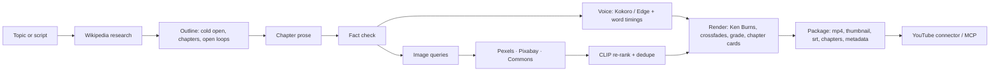

<p align="center">
  
</p>

<p align="center"><b>Open-source video generator for Shorts and long-form.</b><br>
Shorts and long-form documentaries, written from real sources, narrated, cut, captioned, chaptered and packaged.<br>
Free and local: no API bills, no watermark, your machine.</p>

<p align="center">
  
  
  
  
</p>

---

## What it makes

| | **Short** | **Long-form** |
|---|---|---|
| Canvas | 1080×1920 | 1920×1080 |
| Length | 30-60 s | 6-15 min, 5-8 chapters |
| Captions | burned-in karaoke | `.srt` for YouTube CC |
| Packaging | 9:16 cover, title, description, tags | 1280×720 thumbnail, chapter timestamps, title options |

Every render ships with `video.mp4`, thumbnail(s), `.youtube.json` (title / description / tags / chapters),
`.srt`, the script, and a credits file for Creative Commons media.

## Built for retention, not just "a video"

The writer follows the structure that keeps viewers past the first 30 seconds
([research notes](docs/RESEARCH.md)):

1. **Cold open** on the most dramatic true moment. No greeting, no logo sting.
2. **Promise**: one specific line about what the viewer will understand.
3. **Stakes**: why it mattered.
4. **Chapters that end on open loops**: a question that pulls into the next chapter.
5. **Payoff** that answers the cold open.

Plus the packaging that earns the click: thumbnail hook and title written as one unit (never
repeating each other), three title options, and chapters YouTube recognises.

## Features

- **Local writer**: Ollama (`qwen3:8b` by default, auto-falls back to any installed model), outline → cold open → chapters.
- **Grounded**: research from the full Wikipedia article; a fact-check pass drops sentences whose numbers or years aren't in the source.
- **Soothing narration, offline**: Kokoro-82M voices, or Microsoft Edge neural voices with no install. Presets: `soothing`, `storyteller`, `documentary`, `warm`, `british`, `energetic`.
- **Pronunciation control**: respell hard names for the voice; captions keep the real spelling.
- **Relevance-ranked footage**: Pexels + Pixabay stock video (free keys) and Wikimedia Commons stills, re-ranked with **CLIP** against each narration line; near-duplicate shots rejected.
- **Cinematic render**: Ken Burns motion, crossfades, film grade, chapter lower-thirds, music ducked under the voice, -14 LUFS loudness, NVENC when your GPU supports it.
- **Mood music**: a local licensed library tagged by mood; generated ambient pad as fallback.
- **Brand templates**: accent colour, fonts, kicker/tagline, default voice and format per channel.
- **Job queue that survives restarts** (SQLite), extra worker processes, optional S3 mirror.
- **YouTube connector**: an MCP server + CLI for your channel: edit, schedule, thumbnails, playlists, captions, retention analytics, uploads, and "make me a video" from Claude.

## Quick start

```bash
git clone https://github.com/MicoleKurt/framewright && cd framewright
pip install -e ".[all]"          # or: pip install -r requirements.txt
ollama pull qwen3:8b             # https://ollama.com (any model works; see FALLBACKS)
framewright serve                # http://localhost:8000
```

Needs Python 3.10+ and [ffmpeg](https://ffmpeg.org) on PATH.

```bash
framewright make "How the Apollo 13 crew made it home" --format long --minutes 10
framewright make "The history of coffee" --format short --voice storyteller
framewright make "Apollo 13" --script examples/apollo-13-long.json --brand noir
framewright voices                       # one sample per voice preset into samples/
```

Optional free keys for real stock video: `PEXELS_API_KEY`, `PIXABAY_API_KEY`.

## Publish from Claude (MCP)

```bash
framewright youtube auth                                  # one-time Google consent
claude mcp add youtube -- python -m framewright.mcp_server
```

Then ask: *"Make a 10-minute video on the Apollo 13 rescue, upload it, add it to my History playlist
and schedule it for Sunday 11 AM Eastern."* Setup and limits: [docs/YOUTUBE_CONNECTOR.md](docs/YOUTUBE_CONNECTOR.md).

## How it works



## Configuration

| Variable | Default | |
|---|---|---|
| `OLLAMA_MODEL` | `qwen3:8b` | writer model |
| `OLLAMA_NUM_GPU` | `0` (CPU) | `-1` lets Ollama use the GPU (needs a recent NVIDIA driver) |
| `FW_VOICE` | `soothing` | default voice preset |
| `FW_CLIP` | `1` | `0` disables CLIP ranking |
| `FW_ENCODER` | auto | force `libx264` / `h264_nvenc` |
| `PEXELS_API_KEY`, `PIXABAY_API_KEY` | – | stock video |
| `FW_S3_BUCKET`, `FW_S3_ENDPOINT` | – | mirror outputs to S3 / R2 / MinIO |
| `FW_MUSIC_DIR` | `music/` | mood library ([music/README.md](music/README.md)) |

## Script format

Write your own script and keep everything else automated:

```json
{
  "title": "Apollo 13", "subject": "Apollo 13", "format": "long", "mood": "tense",
  "pronounce": {"Haise": "Haze"},
  "scenes": [
    {"narration": "Two hundred thousand miles from home, a bang shook the spacecraft ...", "keywords": ["Apollo 13 mission control"]},
    {"narration": "...", "keywords": ["Apollo 13 lunar module Aquarius"], "anchor": false, "pause": 0.8, "chapter": "The lifeboat"}
  ],
  "thumbnail": {"label": "Apollo 13", "hook": "Houston, we've\nhad a problem", "scene": 0},
  "youtube": {"title": "...", "description": "...", "tags": ["..."]}
}
```

`anchor: false` uses keywords as-is; `chapter` starts a chapter (long-form); `rate` / `pause` tune pacing per scene.

## Licensing of what you publish

Framewright's code is MIT. Media keeps its own licence: Commons files are credited automatically in
the description and `.credits.txt`; Pexels/Pixabay don't require credit; YouTube clips are
restricted to Creative Commons (CC BY) and credited. Kokoro is Apache-2.0. Check your music's licence.

## Roadmap

- TikTok / Instagram publishing once their APIs allow it without app review
- On-screen maps and timeline graphics for long-form
- A/B thumbnail variants from the title options
