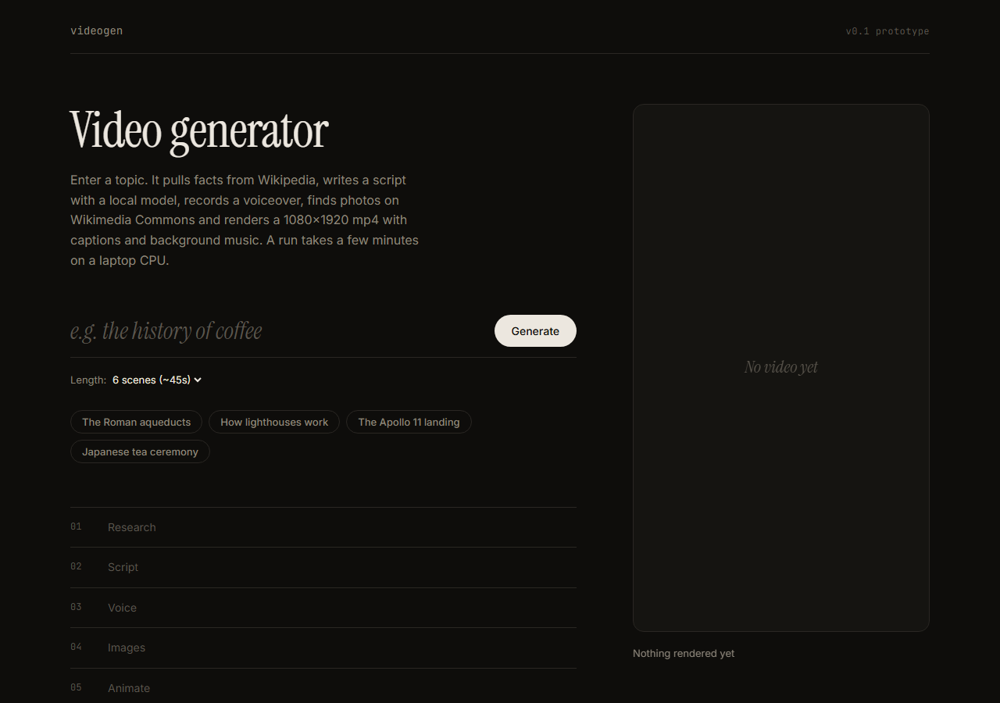
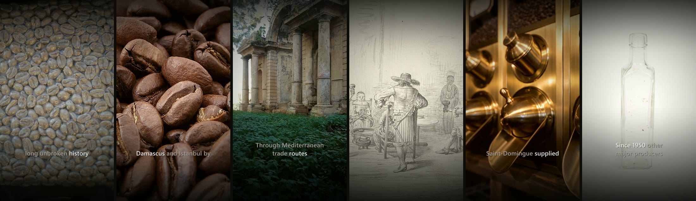
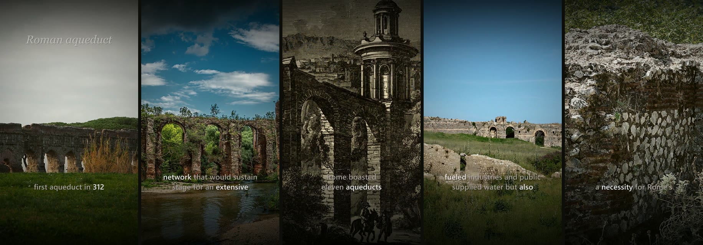
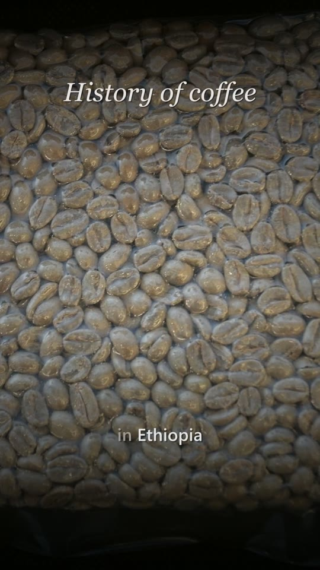
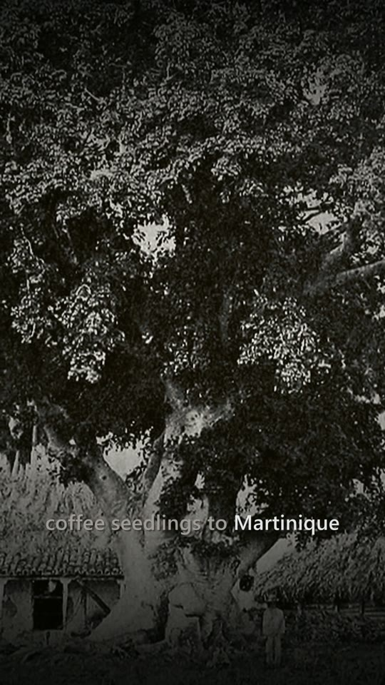
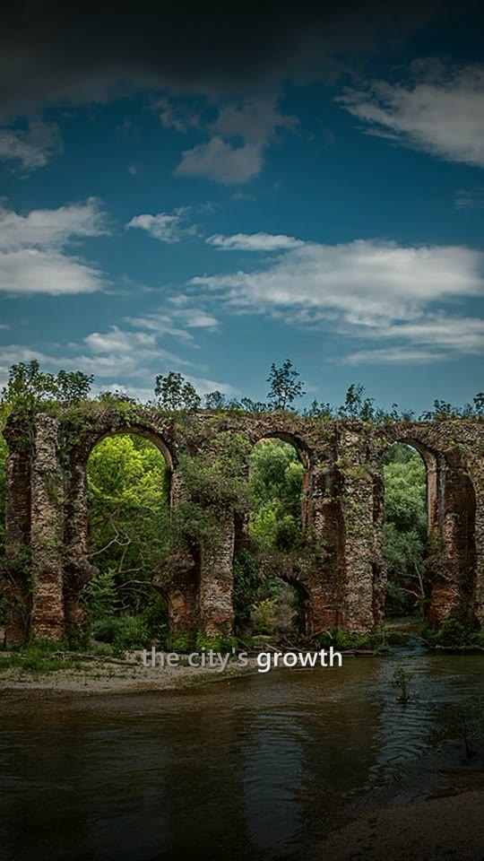

# videogen: topic in, vertical mp4 out

Automated video generator prototype (Manos Corp trial task). Give it a topic, it returns a
1080×1920 mp4 with a written script, neural voiceover, real photos/footage with motion,
word-synced captions, a generated music bed, and a film-style grade. No paid APIs, no keys.

**Sample output:** [history-of-coffee.mp4](https://github.com/MicoleKurt/video-generator/releases/download/v0.1/history-of-coffee.mp4) (63s, made from the single prompt "the history of coffee")

```
python generate.py "the history of coffee"          # CLI
python server.py                                      # web UI → http://localhost:8000
```

## Screenshots

**Web UI**: type a topic, watch each stage complete, preview and download the mp4.



**Generated video: "the history of coffee"** (one frame every ~10s)



**Generated video: "the Roman aqueducts"**



| Title card | Word-synced captions | Captions on archive imagery |
|---|---|---|
|  |  |  |

## Pipeline

| Stage | What happens | Tool |
|---|---|---|
| Research | Finds the best Wikipedia article, pulls the intro as grounding facts | Wikipedia API |
| Script | Local LLM writes the narration as plain prose (one paragraph per scene), then a second call turns each paragraph into image search queries (JSON). Lines with stock AI phrases ("testament", "journey"...) are dropped; too-short output is retried; Wikipedia sentences are the fallback if the LLM is down | Ollama `qwen2.5:7b` |
| Voice | Neural TTS per scene, with **word-level timestamps** | edge-tts |
| Footage | Subject-anchored queries → real stock footage (Pexels, if `PEXELS_API_KEY` set) or Wikimedia Commons photos. De-duplicated across scenes | Pexels / Commons |
| Motion | Ken Burns zoom/pan on stills (alternating direction), crop/loop on video | ffmpeg `zoompan` |
| Captions | Phrase-grouped captions that break on pauses; spoken word white, the rest grey; serif title card; top/bottom shade so text reads on any photo | ASS subtitles + ffmpeg |
| Music | Ambient chord pad synthesized in ffmpeg — zero licensing risk | ffmpeg `aevalsrc` |
| Mix | Music side-chain ducked under the voice, loudness-normalised to −14 LUFS (platform standard) | ffmpeg |
| Grade | Contrast, muted warm palette, vignette, grain, fades | ffmpeg |

Every stage degrades instead of crashing: no LLM → Wikipedia script; no image → drifting
gradient card; flaky TTS/429s → retries with backoff.

## Layout

```
videogen/research.py  Wikipedia facts, Commons/Pexels search, downloads
videogen/script.py    LLM prompt, validation, fallback
videogen/voice.py     TTS + word timings
videogen/render.py    all ffmpeg: clips, captions, music, final mix/grade
videogen/pipeline.py  orchestration + progress callback
server.py, web/       stdlib HTTP server + single-page UI (job queue, progress, preview)
```

## Notes from building it

- **Why prose, then JSON:** with `format: json` the 7B model wrote 6–11 word fragments. Asking for
  plain paragraphs gave proper 20–30 word narration with dates and names.
- **CPU by default:** Ollama's CUDA runner crashed on this machine (`device kernel image is invalid`),
  so `OLLAMA_NUM_GPU=0` is the default. A full 6-scene run is about 5–10 minutes on CPU.
- **Known limitation:** a 7B model occasionally garbles a fact (e.g. merges two sentences from the
  source). A stronger model or a fact-check pass against the source text would fix that.
- Wikimedia rate-limits parallel downloads (HTTP 429), so media is fetched serially with backoff.

## How to run it

### 1. Install the tools (one time)

| Tool | Windows | macOS |
|---|---|---|
| Python 3.11+ | `winget install Python.Python.3.11` | `brew install python` |
| ffmpeg | `winget install Gyan.FFmpeg` | `brew install ffmpeg` |
| Ollama | `winget install Ollama.Ollama` | `brew install ollama` |

Restart the terminal afterwards so `python`, `ffmpeg` and `ollama` are on your PATH.

### 2. Get the code and dependencies

```bash
git clone https://github.com/MicoleKurt/video-generator.git
cd video-generator
pip install -r requirements.txt
ollama pull qwen2.5:7b
```

### 3. Generate a video

**Web UI** (recommended):

```bash
python server.py
```

Open http://localhost:8000, type a topic (or click one of the examples), pick a length and press
**Generate**. Progress shows step by step; when it finishes the video plays in the page with a
**Download mp4** link and the generated script underneath.

**Command line:**

```bash
python generate.py "the history of coffee" --scenes 6
```

The mp4 (plus a `.json` with the script) is written to `output/`. Intermediate files
(voice clips, images, captions) are kept in `output/<topic>-<timestamp>/` for debugging.

### 4. Optional settings (environment variables)

| Variable | Default | Purpose |
|---|---|---|
| `OLLAMA_MODEL` | `qwen2.5:7b` | Any Ollama model, e.g. `llama3.1:8b` |
| `OLLAMA_NUM_GPU` | `0` (CPU) | Set `-1` to let Ollama use your GPU (much faster if it works) |
| `PEXELS_API_KEY` | none | Free key from pexels.com/api: adds real stock **video** footage |
| `PORT` | `8000` | Web UI port |

### Troubleshooting

- **Script falls back to Wikipedia sentences:** Ollama isn't running or the model isn't pulled.
  Run `ollama list`; start it with `ollama serve`.
- **`CUDA error` from Ollama:** keep `OLLAMA_NUM_GPU=0` (the default).
- **`429 Too Many Requests` lines in the log:** Wikimedia throttling; the pipeline retries and
  skips to the next image automatically.
- **A run takes 5-10 minutes:** expected on CPU; most of it is the LLM and the zoom animation.

### Tests

```bash
python tests/test_captions.py
```

## What I'd add next

1. **Footage relevance scoring** — CLIP / vision model to rank candidate images against each
   narration line; today relevance depends on search quality.
2. **Real stock video by default** (Pexels/Pixabay) + crossfades between shots.
3. **Better LLM** (Claude via API) for sharper hooks; keep local model as the free fallback.
4. **Job queue + storage** (Redis/RQ or Postgres-backed, S3 output) so renders survive restarts
   and run in parallel workers.
5. Music from a licensed library matched to mood; brand templates (fonts/colors/intro) per channel.
6. Auto-upload to YouTube Shorts/TikTok with generated title, description and tags.
